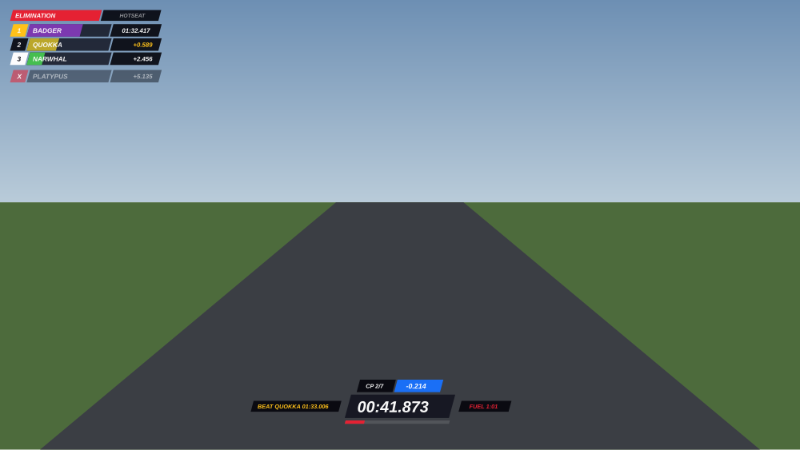
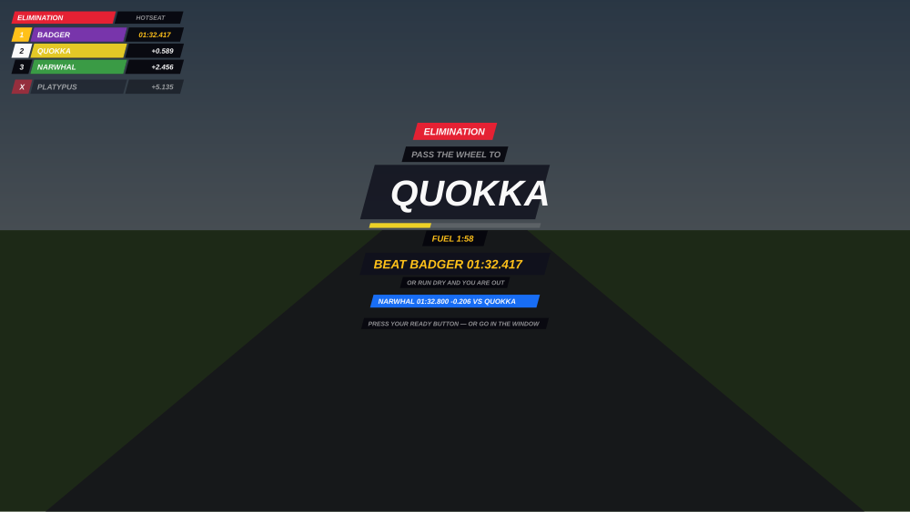

# TM Hotseat — Trackmania-style hotseat mode for Assetto Corsa


Play hotlap battles with friends on **one PC**, Trackmania Hotseat style. Everyone gets a
random nickname, takes turns setting laps on a shared "fuel" budget, and once everyone has
a time it turns into elimination: the slowest player drives and must beat the player above
them before their fuel runs out.

Built as a **CSP Lua app** (requires [Custom Shaders Patch](https://acstuff.club/patch/)).

## How it plays

1. **Setup** — pick the number of players (2–8) and the fuel budget, and bind the
   **GO / Restart** button (required to start). Everyone gets a random unique noun as their
   nickname, all from one random category (Animals, Fruit & Veg, Space, Workshop, Mythical). The default fuel budget scales with track length (longer track = more
   fuel) and can be tweaked in 30-second steps.
2. **Opening round** — players drive one at a time in a shuffled order. Your **fuel is a
   personal time budget**: it drains for every second of your turn and is *not* the car's
   real fuel tank. Press **Restart Lap** (your bound button, the app window button, or `R`
   while the window is focused) to teleport back to the line at any time — your fuel keeps draining, just
   like Trackmania. Bind **GO / Restart** to a wheel button in the setup screen so you never
   need the mouse. As soon as you complete one **valid** lap (track cuts void the lap),
   your fuel drain pauses and the wheel passes to the next player.
3. **Elimination** — once everyone has a time, the **worst-ranked player drives** and must
   beat the time of the player directly above them. Beat it and the wheel passes to the
   player you just demoted (they're last now). Finish a lap that doesn't beat it and you're
   sent back to the grid for another standing-start attempt, so nobody gets a flying start
   the next player wouldn't. Last player standing wins.
4. **Last chance (overtime)** — running out of fuel doesn't end your turn on the spot: you
   get a **last-chance lap** to finish the one you're on. Set a valid lap and you survive;
   **restart while out of fuel and you forfeit** — the wheel passes on (and in elimination
   that means you're out). An amber banner shows while you're in overtime.
5. **Ghosts** — while driving you see up to two ghosts replaying in real time against your
   lap clock: 👑 the overall leader's best lap and ▲ the best lap of the player directly
   above you. Each ghost is painted its player's leaderboard colour, is visual only (no
   collisions), waits on the line until you cross it, and hides while it overlaps your car.
6. **Checkpoints** — the lap is split into 3–10 checkpoints (by track length). Crossing one
   flashes your split against the time you're chasing: **blue** = ahead, **red** = behind.

Sound cues play a **low buzz** when you void a lap (cut) and a **bright chime** when the
wheel passes to the next player.

### Trackmania HUD

| Driving | Handover |
|---|---|
|  |  |

*(Rendered from the real HUD code by `tools/render_hud_preview.lua`; in-game text is
Segoe UI Black Italic.)*

The HUD is drawn fullscreen, with no window chrome:

- **Top-left leaderboard** — slanted plates in each player's colour that drain with their
  fuel; gaps to the leader; the time you must beat in gold; eliminated players below.
- **Bottom-centre** — lap clock, checkpoint splits, fuel gauge, and the target you're chasing.
- **Banners** — LAP INVALID, LAST CHANCE, and a full-screen "pass the wheel to …" card
  between turns, then the winner card.

The app window becomes a small control panel (GO / Restart / settings). It hides itself
while someone is driving and reopens between turns; you can reopen it from the taskbar at
any time — the game keeps running and your bound button still works.

## Installation

**Requirements:** [Content Manager](https://acstuff.club/app/) and **Custom Shaders Patch
0.1.79 or newer** (0.2.x recommended).

### Quick install (recommended)

1. Download **Source code (zip)** from the
   [v2.0.0 release](https://github.com/amirldn/ac-hotseat-trackmania/releases/tag/2.0.0).
2. **Drag the zip straight into Content Manager** — it detects the `apps/lua/tm_hotseat`
   folder inside and installs it for you. Done.
3. Start any **single-player Practice or Hotlap session** (one car, any track), then open
   the right-side apps taskbar and enable **TM Hotseat**. The HUD draws itself top-left;
   park the app window anywhere else (it would cover the leaderboard top-left).

### Manual install

1. Download and unzip the release (or clone this repo).
2. Copy the `apps/lua/tm_hotseat` folder into your game folder so you end up with:
   ```
   ...\SteamApps\common\assettocorsa\apps\lua\tm_hotseat\manifest.ini
   ```
3. Start a **single-player Practice or Hotlap session** (one car, any track).
4. In-game, open the right-side apps taskbar and enable **TM Hotseat**. The HUD draws itself top-left;
   park the app window anywhere else (it would cover the leaderboard top-left).

## Notes & troubleshooting

- **HUD not showing / looks wrong**: the HUD is always on; if it fails to draw on your CSP
  build, the app window prints the error and shows the standings itself instead. *HUD size*
  scales it on top of automatic resolution scaling.
- **Controls**: the setup screen has one CSP binding widget, *GO / Restart* — click it, then
  press a key or wheel/pad button. *START GAME* only appears once it's bound. It starts your
  turn on the handover screen and restarts the lap while driving. The app window hides
  itself while driving (reopen it from the taskbar) and comes back between turns.
- **Restart**: GO and Restart restart the AC session, exactly like *Restart session* in
  the pause menu: you land on the session's spawn (the grid in Practice) and the lap clock
  starts as you cross the line. Teleports aren't used — after a CSP teleport AC didn't
  start timing on the next line crossing. The app keeps all scores, fuel levels and turn order across the restart
  (state is also persisted via `ac.storage`, so it survives an app reload; ghost
  recordings live in memory only and are lost on a full AC restart).
- **Lap validity**: a lap is void if more than 2 wheels leave the track (with a short
  grace period for kerb hops), if you teleported mid-lap, or if it covered less than 60%
  of the track length (an out-lap from the spawn point). Set AC's own penalties off —
  the app does its own checking.
- **Ghost model**: ghosts load your car's KN5 (preferring a lighter LOD from `lods.ini`,
  read from `data.acd` too) and paint it one flat colour — the car's own paint depends on
  its CSP config, which a loose model doesn't get, so mod cars came out pink. If the model can't be loaded on your build, a marker cross with the player's name is
  drawn at the ghost position instead.
- **One car only**: run the session with just the player car; the app reads car slot 0.

## Repo layout

```
apps/lua/tm_hotseat/
├── manifest.ini        CSP app manifest (window, render + fullscreen UI callbacks)
├── tm_hotseat.lua      entry point, wires CSP callbacks
├── src/
│   ├── game.lua        fuel, turns, laps, checkpoints, opening/elimination state machine
│   ├── ghosts.lua      best-lap recording, KN5 ghost playback, checkpoint times
│   ├── overlay.lua     fullscreen Trackmania HUD
│   ├── tmui.lua        TM drawing kit: slanted slabs, italic type, palette
│   ├── panels.lua      app window: setup / handover / controls / results
│   ├── controls.lua    bindable GO / Restart button
│   ├── settings.lua    persisted display settings
│   ├── fmt.lua         time formatting
│   ├── nicknames.lua   random noun nicknames (one random category per game)
│   └── sound.lua       2D sound cues (cut buzz, next-player chime)
└── sfx/                invalid.wav, next.wav
tests/
├── test_game.lua       headless test of the state machine
└── test_panels.lua     smoke test: every window panel, every phase, both HUD modes
tools/
└── render_hud_preview.lua  renders the fullscreen HUD to SVG without the game
```

## Development

The game logic runs headless with the `ac`/`ui` globals stubbed — from the repo root:

```
luajit tests/test_game.lua
luajit tests/test_panels.lua
```

`test_game.lua` covers the full flow (opening laps, cut-lap and out-lap rejection,
checkpoint splits, elimination handovers, fuel-out elimination, overtime, teleport
verification, restart persistence, winner detection). All CSP calls that vary between
builds are wrapped in `pcall` with fallbacks.

To eyeball HUD changes without launching AC:

```
luajit tools/render_hud_preview.lua out/ && rsvg-convert -w 1200 out/3_handover.svg -o handover.png
```
